# Dhriti

A calm, verified first-response web app for women in India facing online harassment, stalking, blackmail and unsafe journeys. Dhriti turns "what do I do?" into a short, guided path: a safety plan, verified helplines and laws, an on-device evidence log, and an AI guide (Sakhi) that is only allowed to cite a single verified data file.

> Dhriti is a guidance tool, not legal advice, and it is not an emergency service. In immediate danger, call **112**.

## Contents

- [Screenshots](#screenshots)
- [Features](#features)
- [Project status](#project-status)
- [How it works](#how-it-works)
- [Tech stack](#tech-stack)
- [Project structure](#project-structure)
- [Getting started](#getting-started)
- [Configuration](#configuration)
- [API reference](#api-reference)
- [Privacy and data handling](#privacy-and-data-handling)
- [Known limitations](#known-limitations)
- [Testing](#testing)
- [Demo](#demo)
- [Roadmap](#roadmap)

## Screenshots

**On a phone**

<p align="center">
  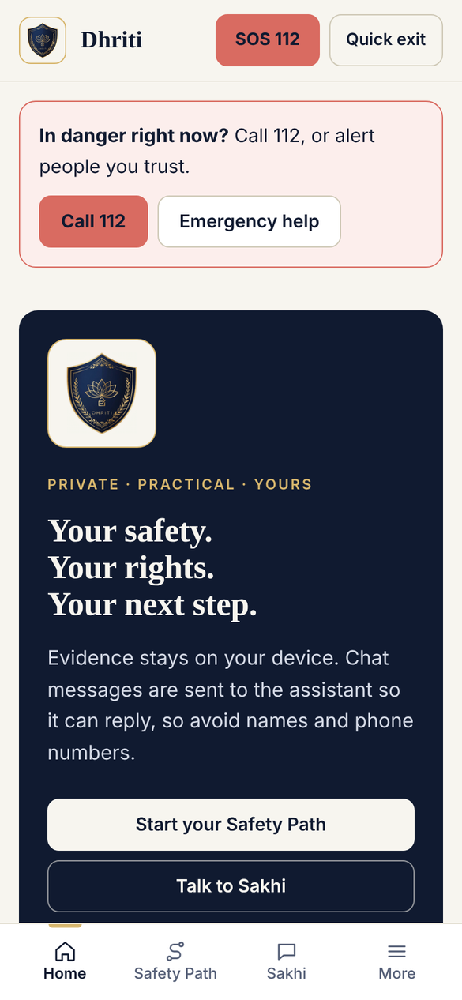
  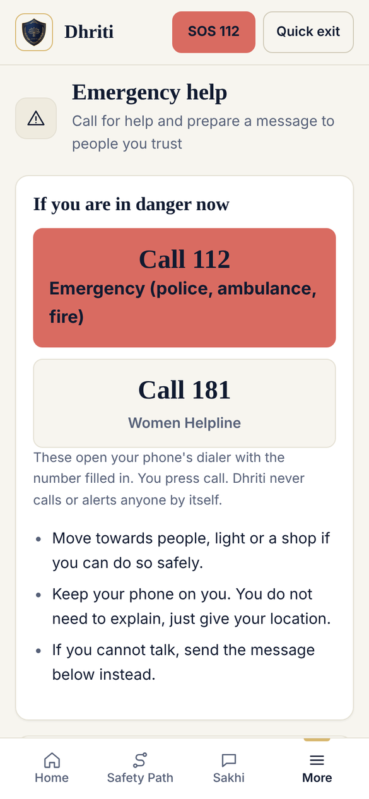
  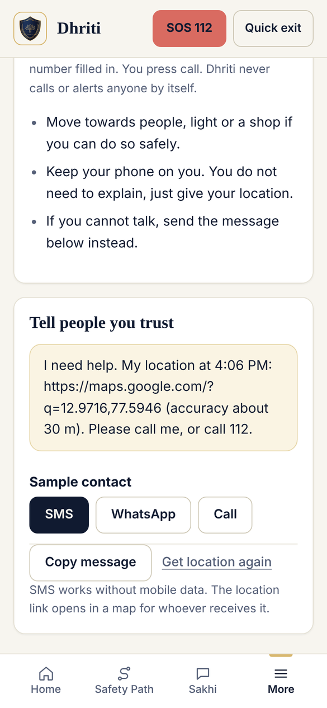
  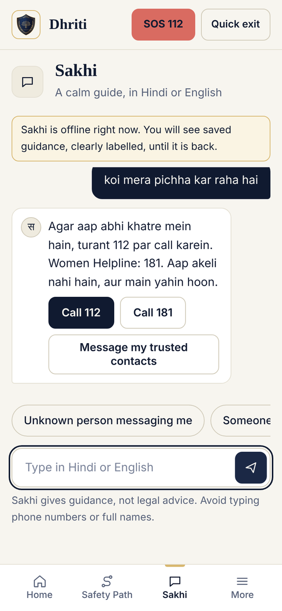
</p>

*Home with the always-visible emergency bar, Emergency help, the prepared message for a saved contact (sample data), and Sakhi's call buttons after a danger message. Captured from the static preview build in a headless browser, so Sakhi shows its labelled offline guidance.*

**On a computer**

| | |
|---|---|
| 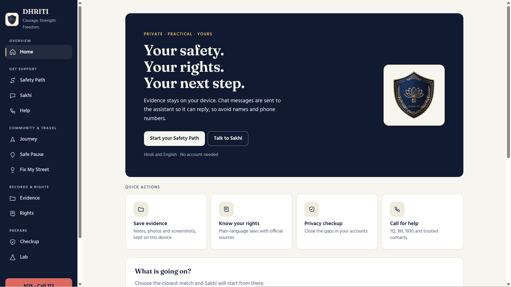 **Home** | 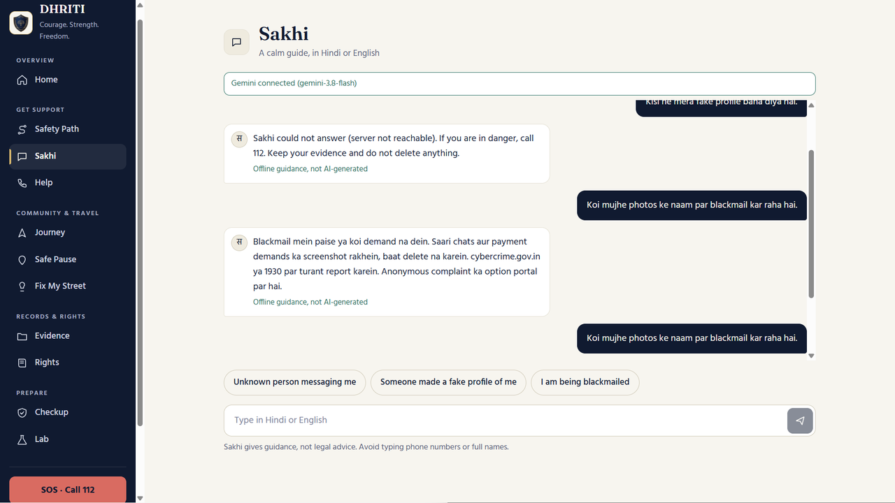 **Sakhi**: the offline fallback appears when the server cannot be reached |
| 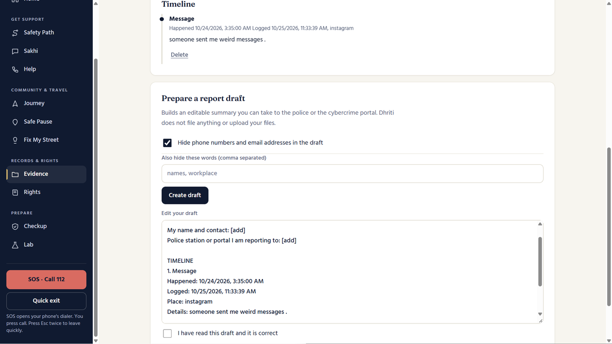 **Evidence**: timeline and redacted report draft | 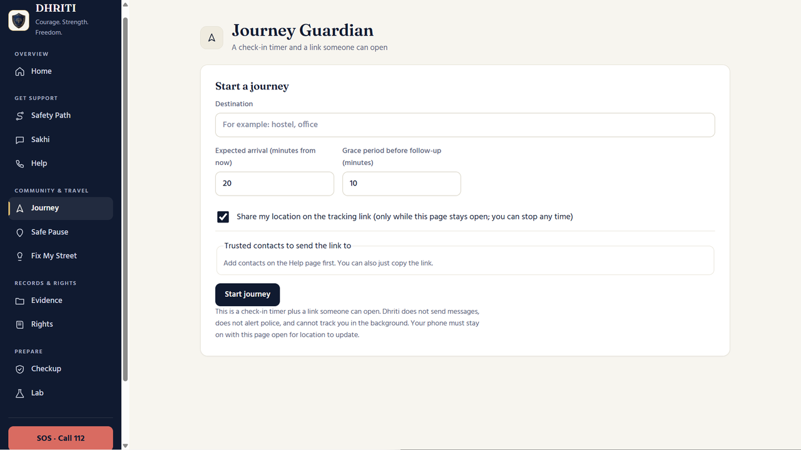 **Journey Guardian** |
| 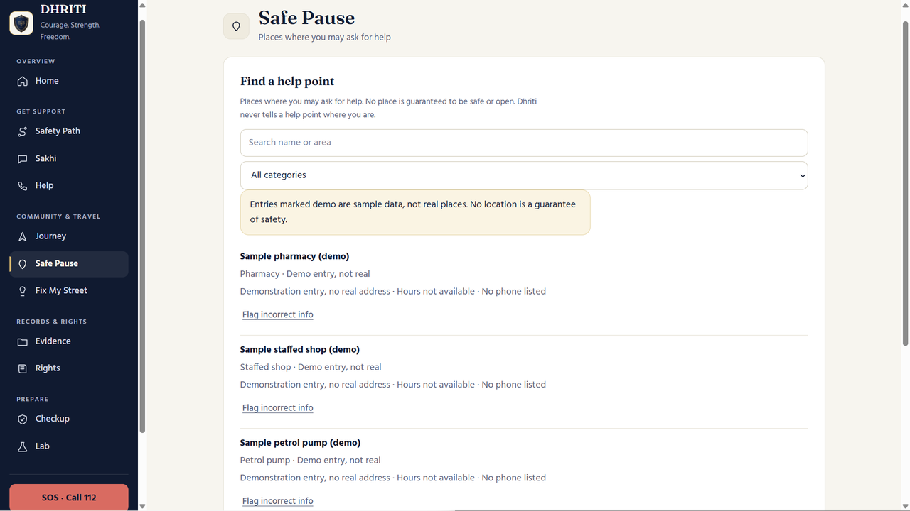 **Safe Pause**: demo entries are labelled | 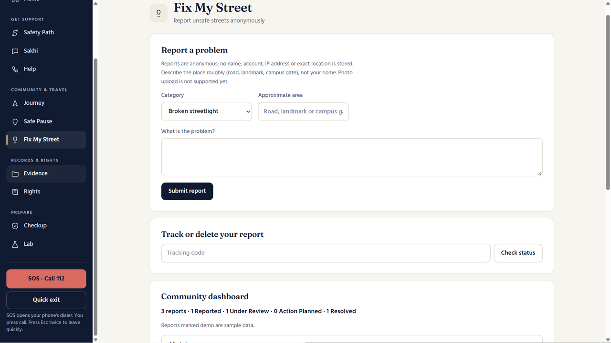 **Fix My Street** |
| 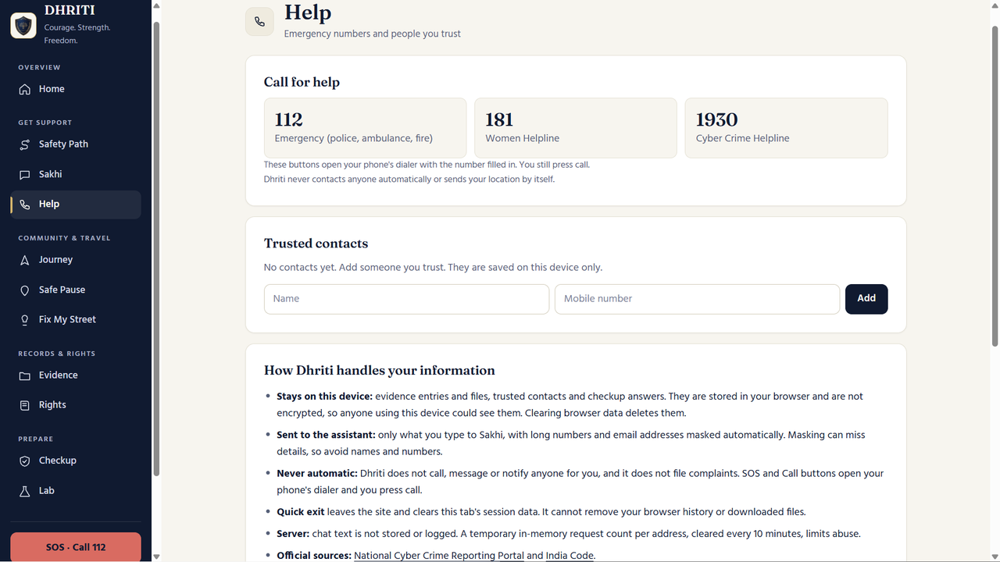 **Help**: verified numbers, trusted contacts, privacy notes | 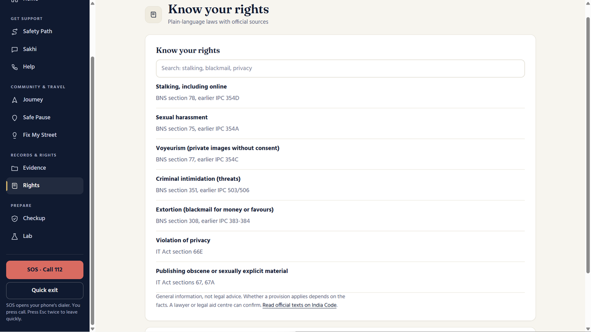 **Know your rights** |
| 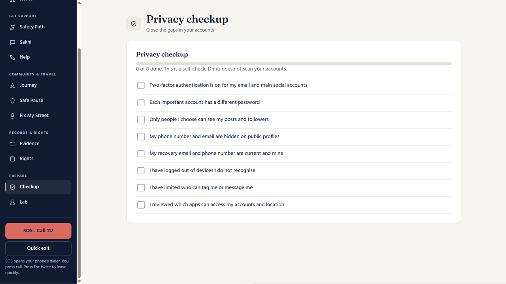 **Privacy checkup** | 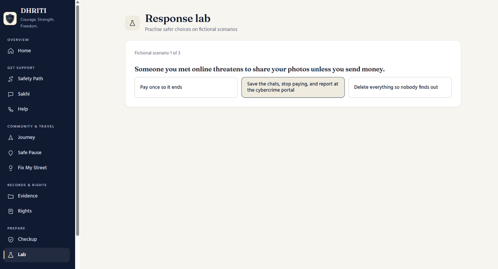 **Response lab** |

*The desktop screenshots were taken before the Emergency help page and Discreet mode were added, so the sidebar in them does not list Emergency help.*

## Features

| Module | What it does |
|---|---|
| **Emergency help** | Big Call 112 and Call 181 buttons, then one tap to get your location and prepare a message for each trusted contact (SMS, WhatsApp, share or copy). Works from an always-visible bar on Home. Dhriti sends nothing itself: you press send in your own app. SMS works without mobile data. |
| **Sakhi** (AI guide) | Streaming chat in Hindi, Hinglish or English, replies under 120 words and at most 4 steps. A danger message shows Call 112 / 181 buttons immediately, even if the server is down. Falls back to labelled offline guidance if the AI is unavailable. |
| **Safety Path** | Pick a situation, answer two safety questions, get a plan with "Provisions that may apply" and verified help. |
| **Evidence** | Record incidents with notes and files. Each file gets a SHA-256 fingerprint computed in the browser. Builds a timeline and a redacted report draft to take to the portal (this is not a filed complaint). |
| **Rights** | Plain-language laws (BNS, IT Act) with official references. |
| **Journey Guardian** | Set a destination, expected arrival and grace period; share an expiring link. Location is shared only while sharing is on. |
| **Safe Pause** | Searchable help points (pharmacies, petrol pumps, campus desks) with public flagging and admin verification. |
| **Fix My Street** | Anonymous reports of unsafe infrastructure with a tracking code, status history and a public dashboard. |
| **Help, Checkup, Lab** | Call-for-help page with trusted contacts, Discreet mode, an erase-everything button, a privacy checkup, and a scenario quiz. |
| **PWA** | Installable, with a service worker so the shell and helplines open offline. |

All journey, help point and report entries shipped with the server are labelled **demo** and are not real places or complaints.

## Project status

What has been built, and how far it has been checked. Nothing here claims more than was run.

| Area | Status |
|---|---|
| All modules in [Features](#features), PWA, quick exit, erase, discreet mode | Built |
| Client behaviour (navigation and Back button, emergency flow with a mocked GPS fix and with permission denied, contacts, evidence delete, erase, discreet mode, double-Esc exit, danger buttons in Sakhi) | Tested in a headless Chromium at phone size against the static preview build: 35 checks, all passing |
| Server helpers (`chat-utils.js`, `store.js`) | `node --test`: 11 tests, all passing |
| Saving reports and help points (`community.js`) | Checked with 18 assertions run against a stand-in router, all passing. Not yet run through real Express |
| Real Express server, `community.test.js`, `vite build`, live Gemini replies | **Not run in the environment these changes were made in** (no package registry access). Run `npm test` and `npm run build` before submitting |
| Legal review of `verified.js`, translation to other languages, SMS delivery, accounts, CI | Not built |

## How it works

```
Browser (React PWA)                         Express API (Node)                  External
-------------------                         ------------------                  --------
React UI                  /api (Vite proxy) Middleware: CORS allow-list,
IndexedDB: evidence files  ───────────────►  security headers, 30 req/min/IP,
localStorage: notes,                         32 kb JSON limit
  contacts, session                          /api/assistant/chat  ───────────►  Google Gemini
Web Crypto: SHA-256                          /api/* community router
Service worker                               verified.js (contacts, portal,
                                               laws, offline texts)
                                             Journeys: memory only
                                             Reports, help points: memory,
                                               plus JSON files if DATA_DIR set
```

### Sakhi message pipeline

1. **Validate**: message must be a string of 1 to 1000 characters, otherwise HTTP 400.
2. **Danger check**: a keyword pattern (English and Hinglish) returns a fixed reply telling the user to call 112 / 181 and never reaches the model. Response header `X-Source: safety`. The client runs the same pattern (`client/src/danger.js`, kept identical by a test) so the call buttons appear even when the server is unreachable.
3. **Offline or no key**: if the client sends `offline: true` or `GEMINI_API_KEY` is unset, topic-matched static guidance is returned. `X-Source: local`.
4. **Redact and trim**: only the last 6 turns are sent, with phone numbers and emails masked.
5. **Stream from Gemini**: the system prompt embeds the verified data (`contacts`, `portal`, `laws`) and forbids inventing laws, numbers or websites. `X-Source: ai`.
6. **Fallback**: on error, timeout (45 s to first chunk, 30 s idle) or an empty reply, the server returns offline guidance and sets `X-Ai-Error`.

## Tech stack

- **Client**: React 18, Vite 5, plain CSS, service worker, Web Crypto API
- **Server**: Node.js (ES modules), Express 4, `@google/genai`, `cors`, `dotenv`
- **AI model**: Gemini; the model name comes from `GEMINI_MODEL` (code default `gemini-2.5-flash-lite`, overridden by your `.env`)
- **Tests**: Node's built-in test runner (`node --test`)

## Project structure

```
dhriti/
├── client/
│   ├── public/            favicon, logos, manifest.webmanifest, sw.js
│   ├── src/
│   │   ├── App.jsx        shell, navigation, Emergency help, Sakhi, plan, evidence, rights, help, checkup, lab
│   │   ├── danger.js      client copy of the danger pattern
│   │   ├── Community.jsx  Journey Guardian, Safe Pause, Fix My Street, share view
│   │   ├── main.jsx       entry; renders the share view when ?track=<token> is present
│   │   ├── preview.jsx    static-preview entry
│   │   ├── shim.js        in-browser stand-in for /api when there is no backend (preview only)
│   │   └── styles.css
│   ├── index.html
│   └── vite.config.js     dev server and /api proxy
├── server/
│   ├── index.js           app setup, middleware, Sakhi endpoint
│   ├── community.js       journeys, help points, reports, admin routes
│   ├── verified.js        single source of truth: contacts, portal, laws, offline texts
│   ├── chat-utils.js      dependency-free Sakhi helpers (danger check, redaction, history sanitising)
│   ├── store.js           small atomic JSON-file store for reports and help points
│   ├── chat-utils.test.js, store.test.js   dependency-free tests
│   ├── community.test.js  API tests (need Express installed)
│   └── .env.example
├── docs/screenshots/      images used in this README
├── DEMO.md                2:59 demo video script (narration and on-screen steps)
└── README.md
```

## Getting started

### Prerequisites

- Node.js 18 or newer
- A Google Gemini API key (optional: without one, Sakhi uses offline guidance)

### 1. Start the server

macOS / Linux:

```bash
cd server
npm install
cp .env.example .env      # set GEMINI_API_KEY (and optionally GEMINI_MODEL, ADMIN_TOKEN)
npm run dev
```

Windows PowerShell:

```powershell
cd server
npm install
Copy-Item .env.example .env
npm run dev
```

Expected output: `Dhriti API ready at http://127.0.0.1:5000 (AI on, model ...)`. Without a key it prints `AI off` and Sakhi uses offline guidance.

### 2. Start the client

In a second terminal:

```bash
cd client
npm install
npm run dev
```

Open the URL Vite prints (usually `http://localhost:5173`). The dev server proxies `/api` to the backend.

### 3. Verify

```bash
curl http://127.0.0.1:5000/api/health        # {"ai":true,"model":"..."}
```

PowerShell: `Invoke-RestMethod http://127.0.0.1:5000/api/health`

### Production build (client)

```bash
cd client
npm run build
```

The service worker registers only in production builds. The server does not serve the built client; host the `dist/` folder separately and route `/api` to the Express server.

### Troubleshooting

- **Port 5000 busy**: the server exits with a message. On Windows: `netstat -ano | findstr :5000`, then `Stop-Process -Id <PID> -Force`.
- **Server on another port**: set `API_TARGET=http://127.0.0.1:PORT` in `client/.env`.
- **502 `backend_unreachable`** in the browser: the Vite proxy cannot reach the server; make sure it is running. Use `127.0.0.1`, not `localhost`, because Node 18+ on Windows may resolve `localhost` to IPv6.

## Configuration

Server environment variables (`server/.env`):

| Variable | Default | Purpose |
|---|---|---|
| `PORT` | `5000` | API port |
| `HOST` | `127.0.0.1` | Bind address |
| `GEMINI_API_KEY` | none | Enables AI replies. Never commit this. |
| `GEMINI_MODEL` | `gemini-2.5-flash-lite` | Model name. The default applies only if unset; whatever you put in `.env` wins. |
| `GEMINI_TIMEOUT_MS` | `45000` | Wait for the first streamed chunk |
| `GEMINI_BASE_URL` | none | Optional custom Gemini endpoint |
| `CLIENT_ORIGIN` | localhost / 127.0.0.1 on ports 5173 and 5174 | Comma-separated CORS allow-list |
| `ADMIN_TOKEN` | none | Required for `/api/admin/*`. If unset, admin routes return 503. |
| `DATA_DIR` | empty (memory only); `.env.example` sets `./data` | Folder where street reports and help points are saved so they survive a restart. Journeys are never saved. `server/data/` is already in `.gitignore`. |

Client: `API_TARGET` (in `client/.env`) overrides the dev proxy target.

## API reference

All routes are under `/api`. Requests are limited to 30 per minute per IP and 32 kb of JSON.

**Core**

| Method | Path | Notes |
|---|---|---|
| GET | `/health` | `{ ai, model }` |
| GET | `/resources` | Verified contacts, portal and laws |
| POST | `/assistant/chat` | Body `{ message, history?, offline? }`. Streams `text/plain`; see `X-Source` and `X-Ai-Error` headers. |

**Journey Guardian** (owner routes need header `x-owner-token`)

| Method | Path | Notes |
|---|---|---|
| POST | `/journeys` | `{ destination, etaMinutes, graceMinutes?, location? }`; returns `ownerToken` and `shareToken` |
| GET | `/journeys/:id` | Owner view |
| POST | `/journeys/:id/checkin` | Optional `extendMinutes`, `location` |
| POST | `/journeys/:id/location` | Update location while sharing |
| POST | `/journeys/:id/help` | Records a help request on the shared page only; it alerts no one |
| POST | `/journeys/:id/complete` | Ends the journey and clears location |
| POST | `/journeys/:id/stop-sharing` | Stops sharing |
| DELETE | `/journeys/:id` | Deletes the journey |
| GET | `/share/:token` | Public read-only view; expires after the follow-up window |

**Safe Pause**

| Method | Path | Notes |
|---|---|---|
| GET | `/helppoints?q=&category=` | Search |
| POST | `/helppoints/:id/flag` | `{ reason }` |
| POST / PATCH / DELETE | `/admin/helppoints[/:id]` | Admin; PATCH can set `verified` |
| GET | `/admin/flags` | Admin; flagged help points |

**Fix My Street**

| Method | Path | Notes |
|---|---|---|
| POST | `/reports` | `{ category, description, area }`; returns `trackingCode` once. Only a hash of it is stored. |
| GET | `/reports?status=&category=` | Public list plus stats |
| GET / DELETE | `/reports/track/:code` | Track or delete your own report |
| PATCH / DELETE | `/admin/reports/:id` | Admin; statuses: Reported, Under Review, Action Planned, Resolved |

Admin routes require header `x-admin-token`.

## Privacy and data handling

- No accounts. No chat text, identity or IP is stored or logged by the server; the rate-limit table is in memory and cleared regularly.
- Evidence files stay in the browser's IndexedDB and notes in localStorage; nothing is uploaded.
- The address bar and tab title never show which section is open, so browser history does not record, for example, a visit to Evidence. The app's own Back button still works. Discreet mode (Help page) also swaps the tab title and icon for a neutral "Notes".
- With `DATA_DIR` set, only anonymous street reports and help points are written to disk, with tracking codes hashed. Live journeys (locations and share tokens) never are.
- Phone numbers and emails are masked before text is sent to the AI and in report drafts.
- Share links expire automatically; ending a journey or stopping sharing clears the stored location.
- SOS and "call for help" open the phone dialer. Dhriti sends no automatic alerts or SMS.
- **Quick exit** (button, or press Esc twice) leaves the site at once. **Erase data on this device** (Help page) removes everything Dhriti saved in this browser. Neither can clear your browser history or files you downloaded.

## Known limitations

- Journeys are **in memory** and lost on restart, on purpose. Reports and help points survive a restart only when `DATA_DIR` is set. For many users, replace the JSON files with a real database.
- Dhriti cannot alert anyone by itself. Emergency help, Journey Guardian and SOS prepare links that you send or call yourself. SMS delivery would need a gateway and legal review.
- Discreet mode does not rename an installed app or remove browser history.
- Evidence is not encrypted at rest by Dhriti, and a SHA-256 hash shows a file changed, not that it is authentic.
- Location updates work only while the page is open; a web page cannot track in the background.
- All help points and reports are demo data until real entries are added by an admin.
- `server/verified.js` must be re-verified by a legal reviewer before any public launch.

## Testing

```bash
cd server
npm test
```

`chat-utils.test.js` (Sakhi helpers, and a check that the client and server danger patterns match) and `store.test.js` (atomic saves, corrupt-file handling) need no dependencies. `community.test.js` contains API tests for the community router and needs Express installed. See [Project status](#project-status) for what has and has not been run.

## Demo

`DEMO.md` has a timed 2:59 demo video script with narration. When presenting or recording, use fictional details only, and do not claim automatic alerts, encryption, maps, accounts, or that hashes prove authenticity.

## Roadmap

Planned, not yet built: a real database for many users, authenticated admin accounts, SMS or push delivery, verified help-point onboarding, an interface in Kannada and Hindi, more verified helplines (each checked against an official source before it is added), and CI.
